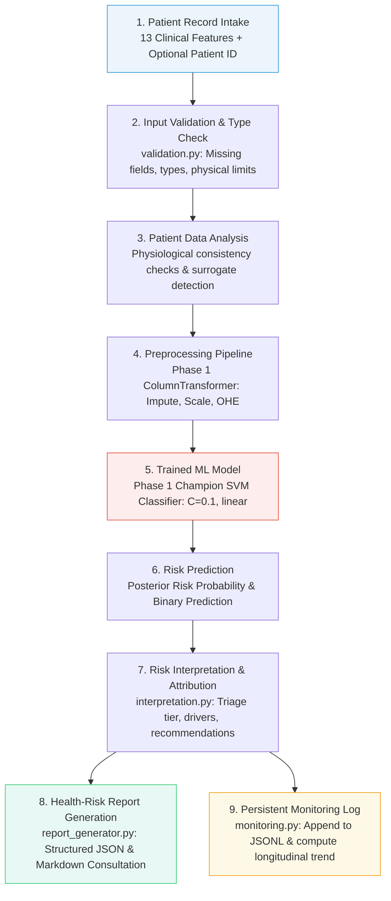

# Phase 2: Heart Disease Risk Assessment AI Agent Architecture

**Project:** Heart Disease Risk Assessment Agent  
**Module Package:** `src/agent/`  
**Agent Orchestrator:** `src/agent/agent.py`  
**Inference Engine:** `models/champion_model.joblib` (Phase 1 Support Vector Machine Pipeline)  
**Persistent Audit Log:** `data/monitoring/patient_monitoring_log.jsonl`  
**Test Suite:** `tests/test_agent.py` (44 Repository Unit Tests Passing)  
**Status:** Completed & Validated

---

## 1. Overview & System Mission

The **Heart Disease Risk Assessment AI Agent** is an autonomous clinical monitoring system designed for early cardiovascular risk stratification, automated diagnostic evaluation, and longitudinal patient tracking.

### Core Philosophy
* **Decoupled Architecture:** The agent is an autonomous orchestration layer cleanly separated from the underlying machine learning model.
* **Zero Model Retraining:** The agent reuses the serialized Phase 1 champion pipeline (`models/champion_model.joblib`) without modification or retraining.
* **Deterministic Grounding:** The agent **never overrides the ML model** with invented predictions, nor does it fabricate clinical claims. It translates mathematical probabilities into standardized clinical triage tiers based on evidence-based AHA/ACC guidelines.
* **Decision Support, Not Diagnosis:** Every report explicitly clarifies that the output is a probabilistic risk stratification tool, not a definitive medical diagnosis.

---

## 2. Defined Clinical Workflow Architecture

The agent executes a strictly validated 9-stage sequential pipeline:



---

## 3. Modular Architecture Breakdown

The Phase 2 system is decomposed into seven distinct modules inside `src/agent/`:

```
src/agent/
├── __init__.py             # Public agent interface exports
├── config.py               # Clinical physiological bounds, risk tiers, and disclaimers
├── validation.py           # Input intake, schema validation, and consistency checking
├── predictor.py            # Pluggable ML model inference interface
├── interpretation.py       # Risk category mapping, feature attribution, and guidelines
├── report_generator.py     # Structured JSON and Markdown clinical report generator
├── monitoring.py           # Persistent longitudinal audit logging and trend analysis
└── agent.py                # Central orchestrator integrating all components
```

### Module Responsibilities

| Module | Source File | Core Responsibilities |
| :--- | :--- | :--- |
| **Agent Orchestrator** | `src/agent/agent.py` | Coordinates the end-to-end workflow; differentiates between new assessments, historical queries, and monitoring trajectories. |
| **Validation Service** | `src/agent/validation.py` | Validates intake against 13 canonical features; checks hard bounds (e.g., blood pressure $50 - 300\text{ mm Hg}$); detects physiological inconsistencies; generates privacy-safe patient IDs (`PT-XXXXXXXX`). |
| **Prediction Engine** | `src/agent/predictor.py` | Implements `BaseRiskPredictor` interface; loads `models/champion_model.joblib`; executes inference without refitting. |
| **Risk Interpretation** | `src/agent/interpretation.py` | Categorizes risk into 4 tiers; identifies positive risk drivers (e.g. ST depression, vessel stenosis) and protective markers; formulates evidence-based lifestyle recommendations. |
| **Report Generator** | `src/agent/report_generator.py` | Renders dual-format outputs: structured JSON dictionaries for EHR/API consumers, and publication-grade Markdown consultation documents. |
| **Monitoring Service** | `src/agent/monitoring.py` | Appends immutable records to `data/monitoring/patient_monitoring_log.jsonl`; computes longitudinal vitals shifts ($\Delta \text{BP}, \Delta \text{oldpeak}$) and risk deltas ($\Delta P$). |
| **Agent Configuration** | `src/agent/config.py` | Centralizes clinical reference ranges, risk thresholds, trend status codes, and mandatory legal disclaimers. |

---

## 4. Where AI-Agent Behavior Exists vs. The ML Model

It is critical to distinguish between the **statistical model** and the **autonomous agent**:

```
+-----------------------------------------------------------------------------------+
|                           AI HEALTHCARE AGENT LAYER                               |
|                                                                                   |
|  1. Intake & Validation: Enforces schema completeness and clinical sanity bounds.  |
|  2. Physiological Consistency: Detects conflicting vitals and crisis ranges.      |
|  3. Longitudinal Memory: Queries prior encounters, computes trajectory deltas.     |
|  4. Triage Attribution: Identifies clinical drivers (e.g. ST depression, ca).     |
|  5. Report Synthesis: Formats structured consultation documents with disclaimers. |
|  6. Audit Logging: Maintains immutable, privacy-conscious monitoring history.     |
+-----------------------------------------------------------------------------------+
                                       │
                         Invokes Pluggable Predictor Interface
                                       │
                                       ▼
+-----------------------------------------------------------------------------------+
|                         STATISTICAL ML PIPELINE LAYER                             |
|                                                                                   |
|  1. Preprocessing: Imputation (median/mode), Standardization, One-Hot Encoding.    |
|  2. Classification: Maximum-margin hyperplane decision (Support Vector Machine).   |
|  3. Calibration: Sigmoid probability calibration (posterior P(CAD | X)).          |
+-----------------------------------------------------------------------------------+
```

### Decoupling & Pluggability
The agent communicates with the ML model strictly via the abstract `BaseRiskPredictor` interface. If a new deep neural network, ensemble, or external API model is developed in the future, it can be plugged into the agent simply by implementing `.predict_risk()`:
```python
# Swapping the underlying model requires ZERO changes to agent workflow logic:
custom_predictor = DeepCardioPredictor(weights_path="models/future_ann.pt")
agent = HeartDiseaseRiskAssessmentAgent(predictor=custom_predictor)
```

---

## 5. Longitudinal Patient Tracking & Differentiation

The agent explicitly differentiates three clinical scenarios:

### 1. New Assessment (`NEW_ASSESSMENT`)
* **Trigger:** Patient ID has no prior encounters recorded in `patient_monitoring_log.jsonl`.
* **Behavior:** Establishes the patient's baseline cardiovascular risk profile and initial vitals snapshot. Trend status is tagged as `FIRST_ASSESSMENT`.

### 2. Follow-Up Assessment (`FOLLOWUP_ASSESSMENT`)
* **Trigger:** Patient ID matches existing historical records in the monitoring log.
* **Behavior:**
  * Compares current risk probability to the immediate previous evaluation:
    $$\Delta P = P_{\text{current}} - P_{\text{prior}}$$
  * Calculates vitals shifts ($\Delta \text{trestbps}, \Delta \text{chol}, \Delta \text{oldpeak}$).
  * Classifies longitudinal trend:
    * `IMPROVED`: Risk decreased by $> 5\%$ ($\Delta P < -0.05$).
    * `DETERIORATED`: Risk increased by $> 5\%$ ($\Delta P > +0.05$).
    * `CRITICAL_ALERT`: Risk escalated into High/Critical tier ($\ge 85\%$).
    * `STABLE`: Risk variation within $\pm 5\%$.

### 3. Monitoring History Query
* **Trigger:** Direct call to `agent.get_monitoring_history(patient_id)`.
* **Behavior:** Returns the full chronological progression across all recorded visits, calculating net baseline-to-latest risk shift and tracking therapeutic response.

---

## 6. Privacy & Safety Safeguards

1. **Input Rejection:** Missing fields, negative blood pressures, impossible ages, or invalid categorical codes immediately raise `PatientValidationError`. The agent never guesses or silently proceeds with corrupted vitals.
2. **Deterministic Grounding:** Model predictions cannot be overridden by prompt heuristics or agent hallucination.
3. **Pseudonymization:** Patient records without explicit identifiers receive deterministic SHA-256 pseudonym tokens (`PT-XXXXXXXX`).
4. **Transparent Disclaimers:** Every report incorporates the mandatory clinical decision-support disclaimer clarifying that the evaluation does not replace diagnostic angiography or specialist physician judgment.

---

## 7. Operational Demonstration & Test Coverage

* **Interactive CLI Demonstration:** Run `python scripts/run_agent_demo.py` to observe baseline intake, follow-up tracking, history retrieval, and input rejection in action.
* **Automated Test Suite:** Run `pytest tests/test_agent.py -v` (11 dedicated agent tests; 44 tests passing across full repository).
